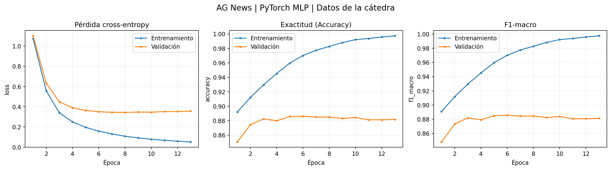
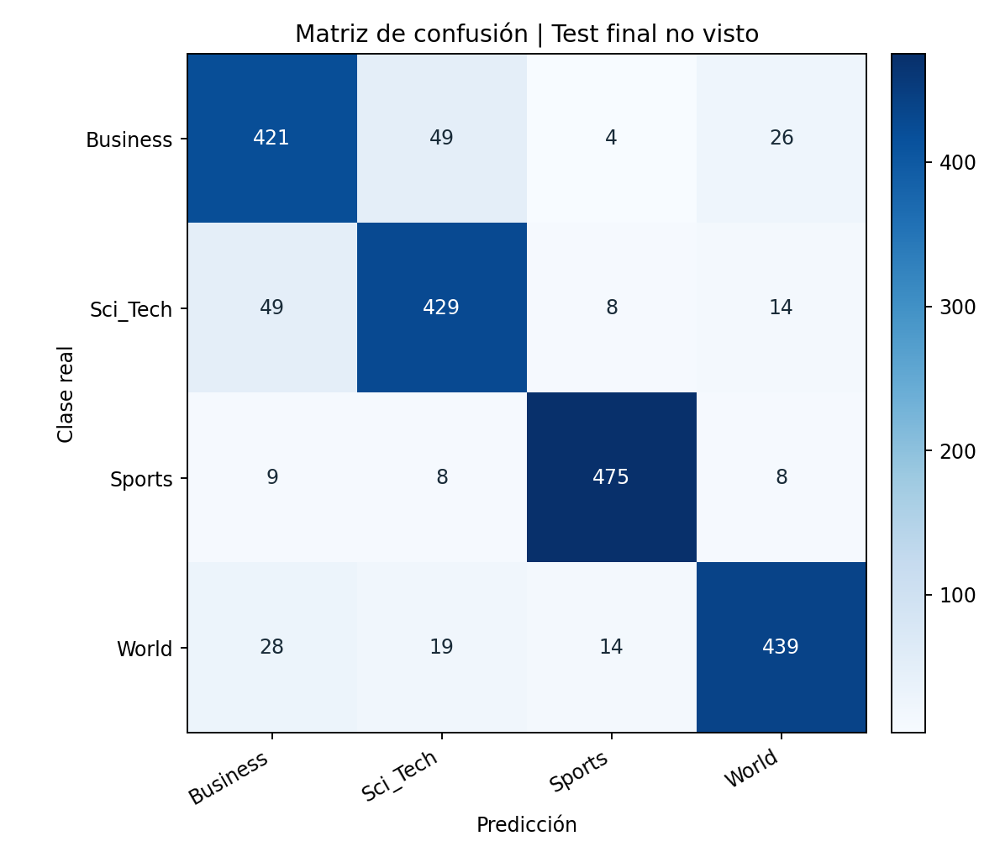
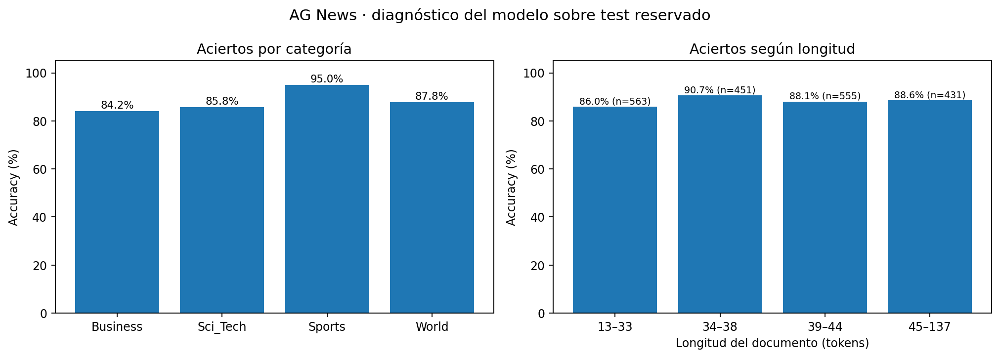
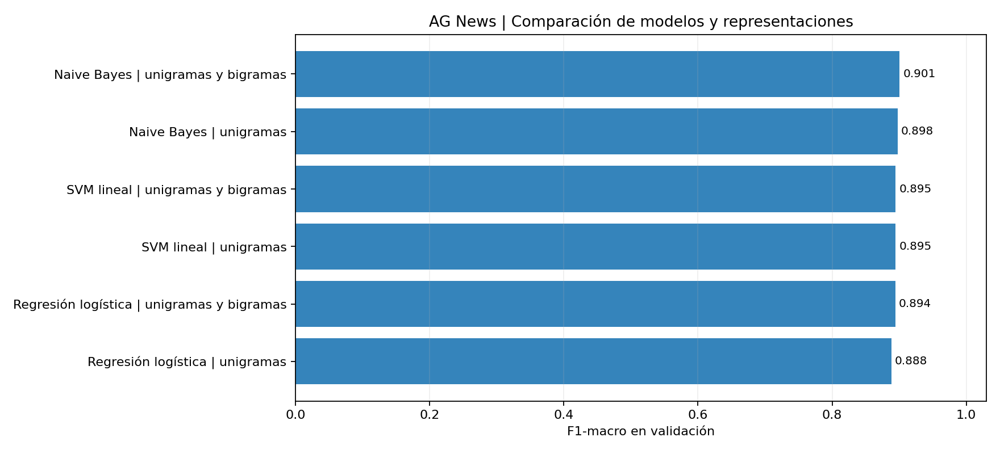
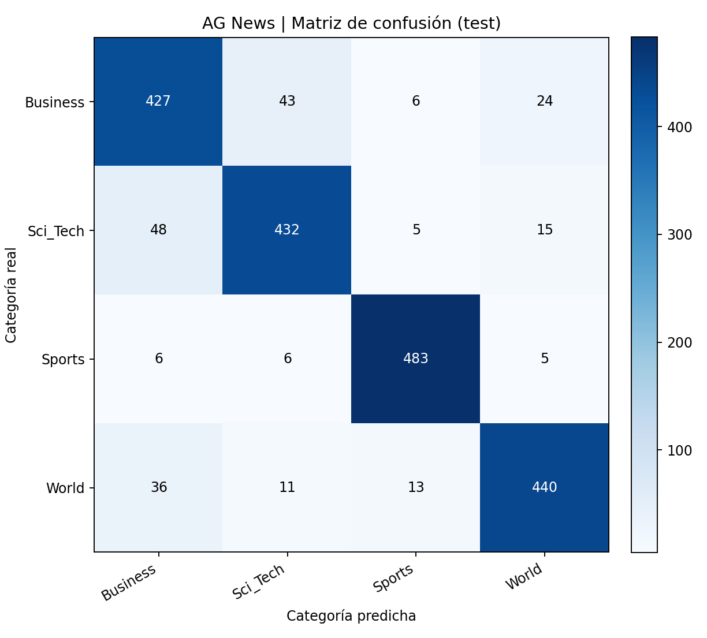

# Data Science III | AG News

## Clasificación de noticias mediante NLP y Deep Learning

Pipeline reproducible de entrenamiento, validación y evaluación de un clasificador multiclase para noticias en inglés. El trabajo utiliza la muestra de **AG News provista por la cátedra**, con cuatro categorías: `World`, `Sports`, `Business` y `Sci_Tech`.

### Organización

```text
├── data/                   # CSV de entrenamiento y prueba, cargador de la cátedra
├── src/                    # Entrenamiento, normalización compartida e inferencia
├── notebooks/              # Ejecución en Jupyter
├── tests/                  # Pruebas automatizadas
├── outputs/                # Métricas y visualizaciones
├── models/                 # Modelos generados localmente
├── docs/                   # Metodología y entrega
├── checkpoint_2_eda/       # Preprocesamiento, informe PDF y análisis exploratorio
├── checkpoint_3_tfidf/     # Clasificadores supervisados clásicos y evaluación
├── requirements.txt
└── README.md
```

### Datos

El conjunto de la cátedra contiene 8.000 noticias de entrenamiento y 2.000 de prueba, con columnas `text` y `label`. A partir de las 8.000 noticias se obtiene una partición estratificada de 6.400 documentos para entrenamiento y 1.600 para validación (`random_state=42`). Las 2.000 noticias de test quedan reservadas para la evaluación final.

Los archivos `data/ag_news_train.csv` y `data/ag_news_test.csv` se incluyen en esta entrega. Proceden del material académico de la cátedra; confirmar con el docente las condiciones de redistribución antes de publicar el repositorio como público. El código detecta tanto `data/` como `data/ag_news/`. El cargador `data/cargar_dataset_catedra.py` admite ambas ubicaciones.

### Modelo y procedimiento

1. Normalización de texto (HTML, URL, minúsculas y espacios).
2. Vectorización TF-IDF con unigramas y bigramas, ajustada exclusivamente sobre entrenamiento.
3. MLP `Linear(6000,128) → ReLU → Dropout(0.35) → Linear(128,4)`.
4. Entrenamiento con `CrossEntropyLoss`, `Adam` y `loss.backward()`.
5. Validación por época con `model.eval()` y `torch.inference_mode()`; selección de pesos por menor `val_loss` y *early stopping*.
6. Evaluación final sobre el conjunto de prueba reservado.

| Hiperparámetro | Valor |
|---|---:|
| Learning rate | `0.001` |
| Batch size | 128 |
| Máximo de épocas | 20 |
| Paciencia (*early stopping*) | 5 |
| Semilla | 42 |
| Vocabulario máximo TF-IDF | 6.000 |
| Optimizador | Adam (`weight_decay=0.0001`) |
| Versión de PyTorch usada | `2.10.0+cpu` |

El dispositivo se selecciona automáticamente entre CUDA, MPS y CPU. Las semillas se fijan en Python, NumPy y PyTorch. Se registran Loss, Accuracy y F1-macro para entrenamiento y validación en cada época.

### Ejecución

Requiere Python 3.10 o superior. Desde la raíz del repositorio:

```bash
python -m pip install -r requirements.txt
python -m unittest discover -s tests -v
python -m src.train
```

Como alternativa, abrir `notebooks/Entrenamiento_Validacion_AGNews.ipynb` y ejecutar todas sus celdas, con los CSV ya ubicados en `data/`.

Después del entrenamiento, para clasificar una noticia nueva (el vectorizador y los pesos se generan localmente):

```bash
python -m src.predict "A new smartphone was unveiled at the technology conference"
```

### Resultados del experimento

Los valores corresponden a la ejecución realizada con los CSV originales de la cátedra.

| Métrica | Resultado |
|---|---:|
| Época seleccionada | 8 |
| Pérdida mínima de validación | 0.3441 |
| Épocas ejecutadas | 13 |
| Accuracy en test | **88.20 %** |
| F1-macro en test | **88.21 %** |
| Pérdida en test | 0.3571 |

La pérdida de validación descendió hasta la época 8. Después aumentó ligeramente mientras la pérdida de entrenamiento continuó bajando, lo cual sugiere sobreajuste incipiente. La selección de los mejores pesos y el *early stopping* permiten controlar este comportamiento.





Los resultados detallados se encuentran en `outputs/historial_epocas.csv`, `outputs/reporte_clasificacion_test.csv` y `outputs/resumen_experimento.json`.

### Diagnóstico de errores

Se incorpora un análisis posterior a la evaluación final: aciertos por categoría, principales confusiones, rendimiento por longitud del documento y errores con alta confianza. Los resultados están documentados en [`docs/analisis_errores.md`](docs/analisis_errores.md).



Para regenerar el análisis a partir de las predicciones finales:

```bash
python -m src.analisis_errores
```

Este diagnóstico describe los resultados del test; no se utiliza para modificar el modelo ni para seleccionar hiperparámetros.


### Alcance

El modelo clasifica la temática de noticias del corpus entregado. Las métricas no demuestran rendimiento equivalente en otras fuentes, períodos o idiomas. El vectorizador no utiliza textos de validación ni de test para ajustar vocabulario o frecuencias. Las siguientes etapas del curso podrán comparar modelos sobre el mismo corpus manteniendo esa separación.

**Referencia:** Zhang, Zhao y LeCun (2015), *Character-level Convolutional Networks for Text Classification*; material AG News de la cátedra.


## Checkpoint 2 | Preprocesamiento y análisis exploratorio

En esta etapa se desarrolló un pipeline de preprocesamiento y diagnóstico del corpus AG News, utilizando las 8.000 noticias del conjunto de entrenamiento.

El procesamiento incluye limpieza mediante expresiones regulares, normalización textual, tokenización y lematización con SpaCy (`en_core_web_sm`).

El análisis exploratorio comprende:

- Distribución de documentos entre las cuatro categorías.
- Longitud de los textos y percentil 95 para orientar la elección de `max_len`.
- Frecuencias léxicas, stopwords y Ley de Zipf.
- Identificación de los 20 bigramas y 20 trigramas más frecuentes.
- Comparación de vocabulario y características entre categorías.
- Evaluación del ruido textual y las necesidades de limpieza.

Los resultados permiten fundamentar las decisiones de representación y modelado que se aplicarán en los siguientes módulos.

El análisis exploratorio se realizó exclusivamente sobre las 8.000 noticias de entrenamiento, sin utilizar el conjunto de prueba para calcular estadísticas ni ajustar el preprocesamiento.

**Archivos del checkpoint:** [Ver análisis exploratorio](checkpoint_2_eda/)

**Informe técnico:** [Consultar PDF](checkpoint_2_eda/reportes/EDA_NLP.pdf)


### Reproducibilidad

El preprocesamiento compartido de entrenamiento e inferencia está en `src/text_utils.py`, de modo que `joblib` pueda recargar el vectorizador TF-IDF desde otro proceso. Los modelos generados no se versionan en GitHub: ejecutar `python -m src.train` antes de usar `python -m src.predict`.

La semilla 42, los parámetros y las versiones utilizadas figuran en `outputs/resumen_experimento.json`. Pueden producirse pequeñas variaciones numéricas entre distintas versiones de bibliotecas o hardware. Para generar nuevamente el informe del segundo checkpoint, instalar también las dependencias en `checkpoint_2_eda/requirements_eda.txt` y el modelo inglés de SpaCy `en_core_web_sm`.


## Checkpoint 3 | Clasificación supervisada con TF-IDF

Se incorporó un benchmark de clasificación clásica sobre **el mismo corpus AG News**, con Naive Bayes Multinomial, Regresión Logística y SVM lineal. El experimento utiliza normalización textual compatible con el EDA, tokenización por palabras con SpaCy y ponderación TF-IDF, conservando las negaciones relevantes. Se evaluaron configuraciones con 10.000 y 15.000 características máximas y con unigramas y bigramas.

La selección se efectuó sobre 6.400 documentos de desarrollo y 1.600 de validación mediante **F1-macro**. Se verificó que no existan textos duplicados tras normalización entre ambas particiones. Para cada candidato, TF-IDF se ajustó únicamente sobre entrenamiento; validación y test se transformaron sin volver a estimar el vocabulario. Una vez elegido el modelo, se reajustó con los 8.000 documentos de entrenamiento y se evaluó sobre las 2.000 noticias del test oficial.

| Resultado del modelo seleccionado | Valor |
|---|---:|
| Modelo | Multinomial Naive Bayes |
| Representación | TF-IDF, unigramas y bigramas, `max_features=15000` |
| Accuracy en validación | 90,12 % |
| F1-macro en validación | 90,07 % |
| Accuracy en test | **89,10 %** |
| F1-macro en test | **89,11 %** |

Los principales errores se producen entre `Business` y `Sci_Tech`, categorías con vocabulario parcialmente compartido. Se documentaron la matriz de confusión, los resultados por categoría y las diferencias entre configuraciones.





### Ejecutar el checkpoint 3

```bash
python -m pip install -r checkpoint_3_tfidf/requirements_tfidf.txt
python -m checkpoint_3_tfidf.entrenar
python -m pytest -q checkpoint_3_tfidf/tests
python -m checkpoint_3_tfidf.verificar
```

La configuración principal utiliza el tokenizador inglés de SpaCy sin lematización, para que el baseline sea reproducible sin descargar modelos lingüísticos. La variante con `en_core_web_sm` está implementada y puede ejecutarse mediante `--lematizar`; **sus métricas deben recalcularse**, porque corresponde a otro experimento.

**Código, parámetros y análisis:** [Checkpoint 3](checkpoint_3_tfidf/) · **Notebook:** [Clasificador TF-IDF](notebooks/Clasificador_TFIDF_AGNews.ipynb).
