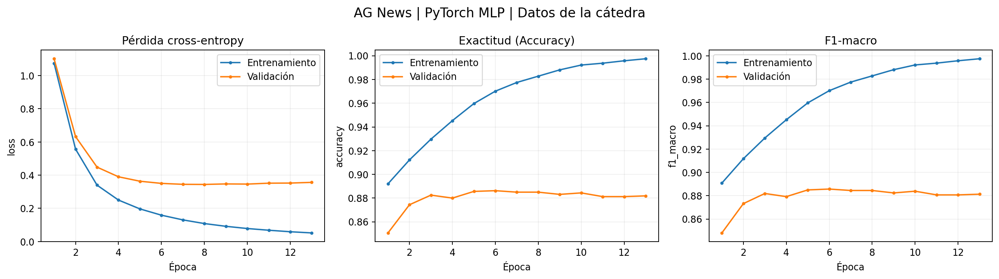
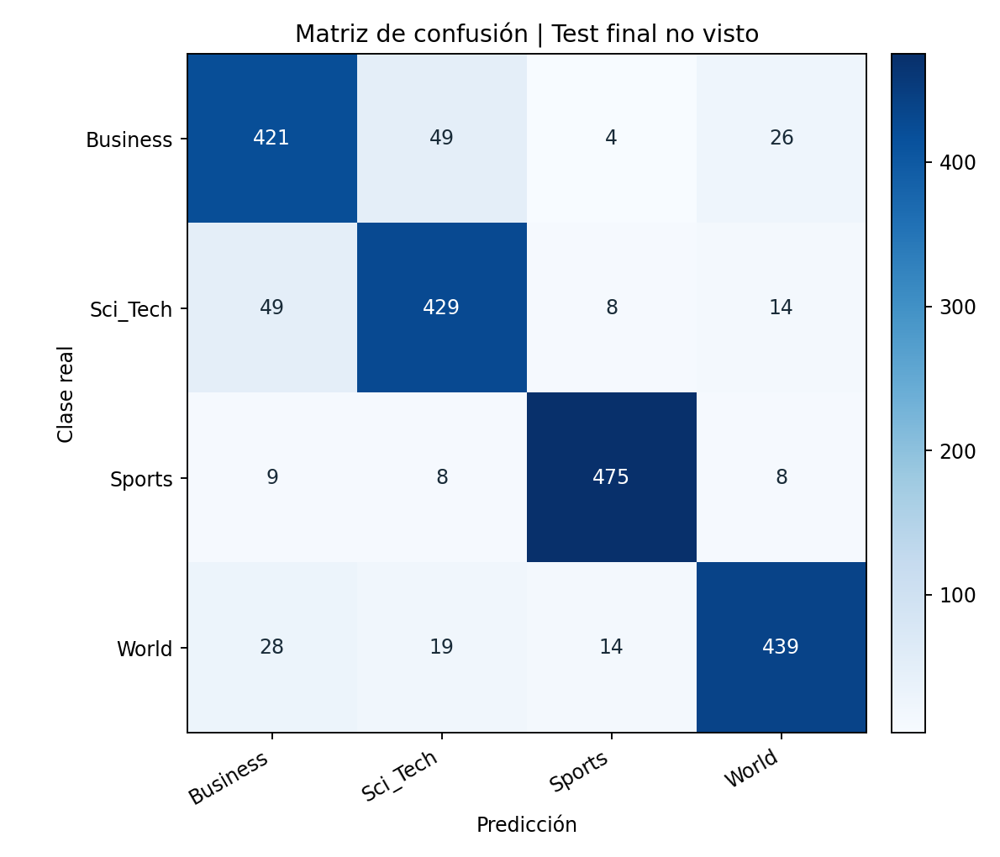
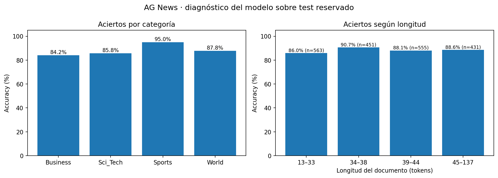

# Data Science III | Checkpoint 1

## Clasificación de noticias AG News con PyTorch

Pipeline reproducible de entrenamiento, validación y evaluación de un clasificador multiclase para noticias en inglés. El trabajo utiliza la muestra de **AG News provista por la cátedra**, con cuatro categorías: `World`, `Sports`, `Business` y `Sci_Tech`.

### Organización

```text
├── data/ag_news/           # CSV oficiales de train y test
├── src/                    # Entrenamiento e inferencia
├── notebooks/              # Ejecución en Jupyter
├── tests/                  # Pruebas automatizadas
├── outputs/                # Métricas y visualizaciones
├── models/                 # Modelos generados localmente
├── docs/                   # Metodología y entrega
├── requirements.txt
└── README.md
```

### Datos

El conjunto de la cátedra contiene 8.000 noticias de entrenamiento y 2.000 de prueba, con columnas `text` y `label`. A partir de las 8.000 noticias se obtiene una partición estratificada de 6.400 documentos para entrenamiento y 1.600 para validación (`random_state=42`). Las 2.000 noticias de test quedan reservadas para la evaluación final.

Los archivos `data/ag_news/ag_news_train.csv` y `data/ag_news/ag_news_test.csv` se incluyen en esta entrega. Proceden del material académico de la cátedra; confirmar con el docente las condiciones de redistribución antes de publicar el repositorio como público. El código utiliza directamente esas rutas. El archivo `data/cargar_dataset_catedra.py` puede cargar ambos CSV desde la carpeta `ag_news/`.

### Modelo y procedimiento

1. Normalización de texto (HTML, URL, minúsculas y espacios).
2. Vectorización TF-IDF con unigramas y bigramas, ajustada exclusivamente sobre entrenamiento.
3. MLP `Linear(6000,128) → ReLU → Dropout(0.35) → Linear(128,4)`.
4. Entrenamiento con `CrossEntropyLoss`, `Adam` y `loss.backward()`.
5. Validación por época con `model.eval()` y `torch.inference_mode()`; selección de pesos por menor `val_loss` y *early stopping*.
6. Evaluación final sobre el conjunto de prueba reservado.

| Hiperparámetro | Valor |
|---|---:|
| Learning rate | `0.001` |
| Batch size | 128 |
| Máximo de épocas | 20 |
| Paciencia (*early stopping*) | 5 |
| Semilla | 42 |
| Vocabulario máximo TF-IDF | 6.000 |
| Optimizador | Adam (`weight_decay=0.0001`) |
| Versión de PyTorch usada | `2.10.0+cpu` |

El dispositivo se selecciona automáticamente entre CUDA, MPS y CPU. Las semillas se fijan en Python, NumPy y PyTorch. Se registran Loss, Accuracy y F1-macro para entrenamiento y validación en cada época.

### Ejecución

Requiere Python 3.10 o superior. Desde la raíz del repositorio:

```bash
python -m pip install -r requirements.txt
python -m unittest discover -s tests -v
python -m src.train
```

Como alternativa, abrir `notebooks/01_Entrenamiento_Validacion_AGNews.ipynb` y ejecutar todas sus celdas, con los CSV ya ubicados en `data/`.

Después del entrenamiento, para clasificar una noticia nueva:

```bash
python -m src.predict "A new smartphone was unveiled at the technology conference"
```

### Resultados del experimento

Los valores corresponden a la ejecución realizada con los CSV originales de la cátedra.

| Métrica | Resultado |
|---|---:|
| Época seleccionada | 8 |
| Pérdida mínima de validación | 0.3441 |
| Épocas ejecutadas | 13 |
| Accuracy en test | **88.20 %** |
| F1-macro en test | **88.21 %** |
| Pérdida en test | 0.3571 |

La pérdida de validación descendió hasta la época 8. Después aumentó ligeramente mientras la pérdida de entrenamiento continuó bajando, lo cual sugiere sobreajuste incipiente. La selección de los mejores pesos y el *early stopping* permiten controlar este comportamiento.





Los resultados detallados se encuentran en `outputs/historial_epocas.csv`, `outputs/reporte_clasificacion_test.csv` y `outputs/resumen_experimento.json`.

### Diagnóstico de errores

Se incorpora un análisis posterior a la evaluación final: aciertos por categoría, principales confusiones, rendimiento por longitud del documento y errores con alta confianza. Los resultados están documentados en [`docs/analisis_errores.md`](docs/analisis_errores.md).



Para regenerar el análisis a partir de las predicciones finales:

```bash
python -m src.analisis_errores
```

Este diagnóstico describe los resultados del test; no se utiliza para modificar el modelo ni para seleccionar hiperparámetros.


### Alcance

El modelo clasifica la temática de noticias del corpus entregado. Las métricas no demuestran rendimiento equivalente en otras fuentes, períodos o idiomas. El vectorizador no utiliza textos de validación ni de test para ajustar vocabulario o frecuencias. Las siguientes etapas del curso podrán comparar modelos sobre el mismo corpus manteniendo esa separación.

**Referencia:** Zhang, Zhao y LeCun (2015), *Character-level Convolutional Networks for Text Classification*; material AG News de la cátedra.
