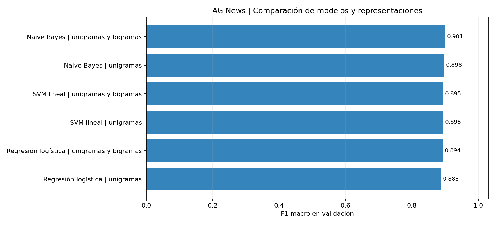
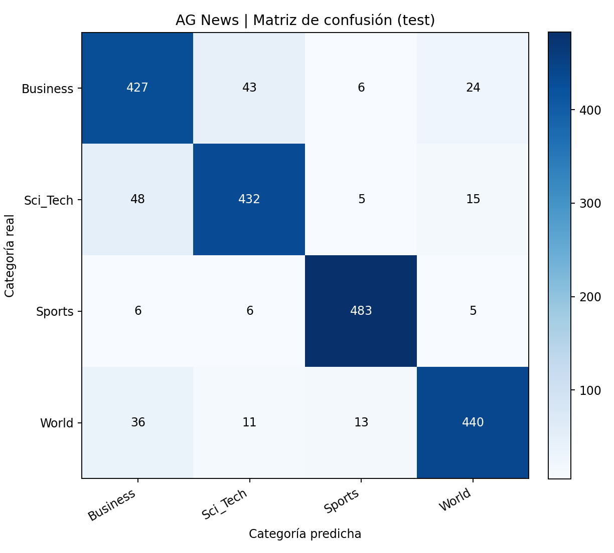

# Checkpoint 3 | Clasificador supervisado con TF-IDF

Se construyó un punto de referencia de clasificación multiclase sobre **AG News**, utilizando la misma muestra de la cátedra trabajada en los checkpoints anteriores: 8.000 noticias de entrenamiento y 2.000 de prueba, distribuidas entre `World`, `Sports`, `Business` y `Sci_Tech`.

## Procedimiento

Se aplicó una normalización equivalente a la del módulo 2: reparación de entidades HTML incompletas, remoción de etiquetas y ruido editorial, conversión a minúsculas y tokenización con SpaCy. La ejecución de referencia utiliza tokenización por palabras (`spacy.blank("en")`), mientras que la lematización estadística con `en_core_web_sm` se ofrece como variante explícita, sin confundir sus resultados con los del experimento principal. Se conservaron las negaciones `no`, `not` y `nor` al filtrar stopwords.

La comparación se realizó mediante una partición estratificada del conjunto `ag_news_train.csv`:

| Partición | Documentos | Función |
|---|---:|---|
| Entrenamiento de desarrollo | 6.400 | Ajuste de TF-IDF y de los clasificadores |
| Validación | 1.600 | Comparación de modelos e hiperparámetros |
| Entrenamiento final | 8.000 | Reajuste del modelo seleccionado |
| Test oficial | 2.000 | Evaluación final, sin intervenir en la selección |

Una comprobación adicional evita que textos idénticos después de normalizar queden repartidos entre desarrollo y validación, preservando el tamaño y el balance de las particiones.

En cada configuración, `TfidfVectorizer.fit_transform` se aplica **exclusivamente al entrenamiento de desarrollo** y `transform` a la validación. Después de elegir el modelo mediante F1-macro, se vuelve a ajustar el vectorizador sobre las 8.000 noticias de entrenamiento y se utiliza solo `transform` sobre el test. La tokenización determinista no aprende vocabulario ni frecuencias del conjunto de prueba.

## Modelos y parámetros

Se compararon seis configuraciones de **Multinomial Naive Bayes, Regresión Logística y SVM lineal**. Los vectorizadores incluyeron `max_features=10.000` o `15.000`, `ngram_range=(1,1)` o `(1,2)`, `min_df=2`, `max_df=0.95` y ponderación logarítmica de frecuencia (`sublinear_tf=True`). Los clasificadores emplearon `alpha=0.5` (NB), `C=2.0` (LR) y `C=1.0` (SVM), con semilla 42.

La comparación utiliza el mismo conjunto de validación para todos los candidatos. Las matrices TF-IDF permanecen **esparsas**, sin convertirlas a arreglos densos.

## Resultados obtenidos

Se seleccionó **Multinomial Naive Bayes con unigramas y bigramas y máximo de 15.000 características**, por obtener el mejor F1-macro en validación.

| Métrica | Validación | Test oficial |
|---|---:|---:|
| Accuracy | 90,12 % | 89,10 % |
| F1-macro | 90,07 % | 89,11 % |

Los resultados detallados se encuentran en [`outputs/comparacion_validacion.csv`](outputs/comparacion_validacion.csv), [`outputs/classification_report.txt`](outputs/classification_report.txt) y [`outputs/reporte_clasificacion.csv`](outputs/reporte_clasificacion.csv).





### Análisis por categoría

`Sports` alcanzó el mejor F1 (0,959), seguido de `World` (0,894), `Sci_Tech` (0,871) y `Business` (0,840). Las principales confusiones se producen entre noticias tecnológicas y económicas, especialmente `Sci_Tech → Business` y `Business → Sci_Tech`. Es una dificultad coherente con el solapamiento temático entre tecnología, empresas y mercados, pero no prueba por sí sola la causa de cada error.

La incorporación de bigramas mejoró el F1-macro de validación del modelo NB en esta comparación. Al filtrar stopwords, algunos bigramas unen términos que no eran contiguos en el texto original. Los modelos clásicos ofrecen un punto de referencia económico e interpretable para las próximas arquitecturas de Deep Learning.

## Ejecución

Ejecutar desde la raíz del repositorio, con Python 3.10 o superior:

```bash
python -m pip install -r checkpoint_3_tfidf/requirements_tfidf.txt
python -m checkpoint_3_tfidf.entrenar
python -m pytest -q checkpoint_3_tfidf/tests
python -m checkpoint_3_tfidf.verificar
python -m checkpoint_3_tfidf.predecir "Researchers unveiled a new processor for smartphones"
```

Para entrenar una variante con **lematización `en_core_web_sm`**, instalar previamente el modelo y ejecutarla de forma explícita:

```bash
python -m spacy download en_core_web_sm
python -m checkpoint_3_tfidf.entrenar --lematizar
```

El uso de `--lematizar` genera un experimento distinto y reemplaza los archivos de resultados locales. Sus métricas deben volver a calcularse; no se atribuyen a esa variante los resultados de la tabla anterior.

El script detecta los CSV tanto en `data/` como en `data/ag_news/`. Guarda los resultados en `checkpoint_3_tfidf/outputs/` y el modelo reproducible en `checkpoint_3_tfidf/models/` (excluido de Git por tratarse de un artefacto regenerable). Los controles de consistencia y las huellas SHA-256 de los CSV se registran en `outputs/resumen_ejecucion.json`.

## Alcance

La exactitud corresponde exclusivamente a la muestra de AG News suministrada por la cátedra. Aunque se compararon tres métodos, el número de configuraciones es limitado y no permite afirmar una superioridad universal. Los resultados del test se utilizaron para describir el modelo seleccionado, no para reajustar hiperparámetros. La comparación con modelos neuronales debe considerar también el costo computacional y las condiciones de evaluación.
